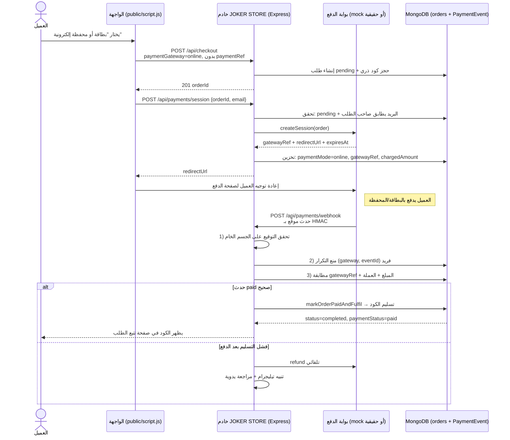
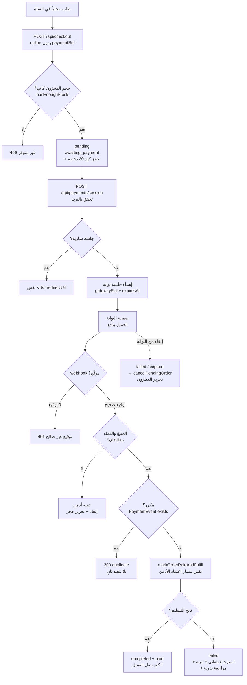

# Joker Store

متجر إلكتروني يدعم عرض المنتجات، السلة، الدفع، وإدارة الأدمن. المشروع مبني بـ Node.js + Express + MongoDB وموجه لخدمة متجر بطاقات رقمية وألعاب.

## المتطلبات
- Node.js 22+
- MongoDB
- npm

## التثبيت محلياً
```bash
npm install
cp .env.example .env
# عدّل القيم داخل .env قبل التشغيل
```

## التشغيل
```bash
npm start
```

## الاختبارات
```bash
npm test -- --runInBand          # اختبارات API والوحدات (Jest)
npm run test:e2e                 # E2E + إمكانية الوصول (Playwright)
npx playwright install chromium  # مرة واحدة لتنزيل المتصفح
```

## النشر على Render
1. اربط المستودع مع Render.
2. اختر خدمة Web Service.
3. استخدم الأمر:
   - Build Command: `npm install`
   - Start Command: `node server.js`
4. أضف المتغيرات البيئية المطلوبة مثل `MONGODB_URI`, `JWT_SECRET`, `ADMIN_PASSWORD_HASH` و `NODE_ENV=production`.
5. Render يمرر كل الطلبات عبر Cloudflare، لذا `req.ip` يساوي IP الوكيل المشترك وليس الزائر.
   - يقرأ `middleware/clientIp.js` عنوان `CF-Connecting-IP` ويضبط `req.clientIp` قبل أي rate limiter.
   - كل حدود المعدّل وقفل الدخول وبصمة جلسة الأدمن مبنية على هذا العنوان.
   - على VPS بلا Cloudflare اضبط `TRUST_CF_CONNECTING_IP=false` لمنع تزوير الترويسة.
   - `app.set('trust proxy', 1)` باقٍ فقط لمعرفة البروتوكول (`req.secure`).
6. استخدم ملف [render.yaml](render.yaml) كإعداد جاهز.
7. فعّل التحقق الثنائي (2FA): `node scripts/generate-totp.js` ثم أضف `ADMIN_TOTP_SECRET` في متغيرات Render.

## النشر باستخدام Docker
```bash
docker build -t joker-store .
docker run -p 5850:5850 --env-file .env joker-store
```

للنشر على خادم خاص مع HTTPS تلقائي، استخدم `docker-compose.yml` و`Caddyfile`:
```bash
cp .env.example .env   # املأ DOMAIN وSITE_URL وAPP_URL وبقية القيم
docker compose up -d --build
```
التفاصيل الكاملة في [DEPLOYMENT.md](DEPLOYMENT.md#migrating-from-render-to-a-private-vps).

## متغيرات البيئة الأساسية
- `PORT`
- `NODE_ENV`
- `SITE_URL` (أصل الموقع العام: CSP/CORS/Socket.IO/روابط البريد وsitemap)
- `APP_URL` (عنوان المتجر داخل تطبيق الأندرويد؛ يرجع إلى `SITE_URL` إن تُرك فارغاً)
- `DOMAIN` (نطاق الاستضافة الخاصة مع docker-compose/Caddy)
- `TRUST_CF_CONNECTING_IP` (`false` على VPS بلا Cloudflare)
- `MONGODB_URI`
- `JWT_SECRET`
- `JWT_USER_SECRET`
- `ADMIN_PASSWORD_HASH`
- `TELEGRAM_BOT_TOKEN`
- `TELEGRAM_CHAT_ID`

## النطاق المخصص وكاش Cloudflare
1. Render → Settings → Custom Domains → أضف النطاق واحصل على هدف CNAME.
2. Cloudflare → DNS → أضف CNAME (Proxy مفعّل) إلى هدف Render، ثم SSL/TLS → Full (strict).
3. Render → Environment → `SITE_URL=https://<domain>` (يُستخدم في canonical وCSP وSocket).
4. Cache Rules: كاش لـ `/image/*` و `/vendor/*` (Edge TTL: شهر)، وBypass لـ `/api/*` و `/admin*` و `/login*`. لا تفعّل Cache Everything على HTML.
5. حدّث `SITE_URL` و`APP_URL` (في لوحة Render/الاستضافة وفي Settings → Variables على GitHub) ثم أعد بناء APK — لم يعد هناك رابط ثابت داخل `capacitor.config.js` بعد الآن.

## تفعيل مزوّد أو الدفع التلقائي
- المزوّدون: املأ `PROVIDER_1_*` (انظر [.env.example](.env.example)) ثم `PROVIDERS_COUNT=1` وأعد النشر، ثم اضغط «مزامنة» من لوحة الأدمن. يتطلب API key وBase URL ومسارات items/balance/purchase وطريقة المصادقة.
- الدفع التلقائي: الهيكل جاهز ومُختبَر عبر بوابة محاكاة، ويُنشَّط بضبط:
  `PAYMENT_GATEWAY` + `PAYMENT_WEBHOOK_SECRET` + `PAYMENT_GATEWAY_ORIGIN` (والمفاتيح عند إضافة البوابة الحقيقية).
  - العقد الموحّد: [providers/payments/types.js](providers/payments/types.js) — كل بوابة تُضاف كملف مستقل يُنفّذ: `createSession` / `verifyWebhook` / `getStatus` / `refund`.
  - المسار: إنشاء الطلب (حجز المخزون) → `POST /api/payments/session` → صفحة البوابة → `POST /api/payments/webhook` (توقيع + منع تكرار + مطابقة المبلغ) → تنفيذ تلقائي.
  - عند فشل التسليم بعد استلام الدفع: استرجاع تلقائي + تنبيه تلجرام + تحويل الطلب للمراجعة اليدوية.
  - الاسترجاع الإداري: `POST /api/admin/orders/:orderId/refund`.
  - محلياً: `PAYMENT_GATEWAY=mock` يعطّل نفسه تلقائياً في الإنتاج ويستخدم صفحة دفع وهمية بلا أموال.
  - عند إضافة البوابة الحقيقية يبقى ملف واحد جديد فقط: `providers/payments/<gateway>.js` + تسجيله في [providers/payments/index.js](providers/payments/index.js).

### سيناريو الدفع الإلكتروني بالتفصيل

#### الرسم التدفقي — المسار الكامل من الضغط على الشراء حتى التسليم



#### مخطط حالات الطلب



#### الحمايات الخمس في الـWebhook

| # | الحارس | التطبيق |
|---|---|---|
| 1 | **التوقيع** | HMAC على الجسم الخام + `timingSafeEqual` |
| 2 | **منع التكرار** | `PaymentEvent` بفهرس فريد `(gateway, eventId)` |
| 3 | **مطابقة الطلب** | بحث بـ `gatewayRef`، مرجع غير معروف → 200 بلا تنفيذ |
| 4 | **مطابقة المبلغ والعملة** | يقارن المبلغ المدفوع بـ `order.price` (تسامح 0.01) و`STORE_CURRENCY` |
| 5 | **مسار تنفيذ موحّد** | `markOrderPaidAndFulfil` — نفس حماية الهامش والحجز الذري لاعتماد الأدمن |

> **قاعدة ذهبية:** العودة من البوابة إلى `/api/payments/return` ليست إثبات دفع أبداً — **Webhhook وحده هو مصدر الحقيقة**.

#### تجربة محلية (بدون أموال)

```bash
$env:PAYMENT_GATEWAY='mock'; $env:PAYMENT_WEBHOOK_SECRET='local-secret'; npm start
# 1. أضف منتجاً للسلة
# 2. اختر "بطاقة أو محفظة إلكترونية" → يُنشأ الطلب
# 3. تُفتح صفحة "بوابة دفع تجريبية" → "إتمام الدفع"
# 4. يُسلَّم الكود تلقائياً ويظهر في صفحة تتبع الطلب
```

#### لتفعيل بوابة حقيقية لاحقاً

1. أضف `providers/payments/<gateway>.js` ينفّذ 4 دوال العقد.
2. سجّله في `providers/payments/index.js`.
3. عيّن في Render: `PAYMENT_GATEWAY` + `PAYMENT_WEBHOOK_SECRET` + `PAYMENT_GATEWAY_ORIGIN` (+ مفاتيح البوابة إن لزمت).
4. لا يلزم تعديل الطلبات أو الواجهة أو الـWebhook.

## سياسة المخزون
- المنتج المحلي يُباع من أكواد `status=available` ويبقى ظاهراً حتى لو نفد (يُعرض «نفد المخزون»).
- المنتج الخارجي يظهر ويُباع فقط إذا كان `providerStock` رقماً موجباً؛ المخزون غير المعروف (`null`) أو الصفري يعني إخفاء المنتج من القوائم والبحث وsitemap وصفحة المنتج.
- الإخفاء مطبّق على مستوى الاستعلامات (`services/inventory.js` → `withDeliverableStock`) في كل مسارات الواجهة، وعلى مستوى الطلب (`hasEnoughStock` → 409 عند النقص)، فلا يمكن تجاوزه من الواجهة.

## الأداء والأصول المبنية
- `public/style.min.css` و`public/script.min.js` و`public/ui.min.js` ملفات مُصغّرة **مُلتزمة في المستودع**.
- الخادم يخدمها تلقائياً في الإنتاج فقط (انظر `MINIFIED_ASSETS` في app.js)؛ التطوير يبقى على المصدر.
- بعد أي تعديل على `style.css` أو `script.js` أو `ui.js` شغّل:
```bash
npm run build:assets      # يعيد بناء الملفات المصغّرة
npm run optimize:images   # يولّد نسخ WebP الناقصة (sharp أو ffmpeg)
```
- CI يفشل إذا كانت الملفات المصغّرة قديمة (وظيفة `assets`).

## المراقبة والسجلات
- سجلات JSON منظّمة على stdout (متوافقة مع Render/Docker): `config/logger.js`.
- كل استجابة تحمل `X-Request-Id`، وتُسجّل مدة الطلب والحالة والمسار.
- `SENTRY_DSN` (اختياري) يفعّل إرسال الأخطاء إلى Sentry؛ لا يُرسل أي بيانات دفع أو كوكيز.
- `GET /health` يعرض الإصدار، مدة التشغيل، حالة قاعدة البيانات والذاكرة.
- إغلاق نظيف عند `SIGTERM`/`SIGINT` (Render يرسله قبل كل إعادة نشر).
- تنبيه تلجرام تلقائي عند استثناء غير ملتقط (مع تهدئة 10 دقائق).

## الخصوصية والكوكيز
- `public/consent.js`: بانر موافقة + Consent Mode v2 (افتراضي: رفض كل غير الضروري).
- `public/analytics.js`: لا يُحمَّل Google Analytics أو Meta Pixel قبل الموافقة.
- الاختيار يُحفظ في `localStorage` بمفتاح `joker_consent_v1`، ويمكن تغييره من رابط «إعدادات الكوكيز» في الفوتر أو `/?cookie-settings=1`.
- `public/sw.js` لا يخزّن `consent.js`/`analytics.js` بشكل يمنع التحديث (شبكة أولاً).

## هيكل المشروع
- server.js: نقطة دخول التطبيق + إغلاق نظيف + معالجة الأخطاء غير الملتقطة
- app.js: إعداد Express والـ middleware + CSP + الصحة
- config/: الإعدادات، التحقق من البيئة، السجلات، Sentry
- services/: خدمات مساندة (تخزين، تنبيهات)
- routes/: تعريف المسارات العامة والإدارية
- controllers/: المنطق التجاري والعمليات
- middleware/: حماية، مصادقة، سجلات، معرّف الطلب
- public/: الواجهة الأمامية العامة
- private/: واجهة الأدمن المحمية
- tests/: اختبارات API والأمان والواجهة الثابتة
- e2e/: اختبارات Playwright (موافقة كوكيز، إمكانية وصول، تخطيط)

## التحقق الثنائي (2FA)
1. شغّل `node scripts/generate-totp.js` واحتفظ بالسر المعروض.
2. أضف `ADMIN_TOTP_SECRET` في متغيرات Render (وفي `.env` محلياً عند الحاجة).
3. أضف الحساب في Google Authenticator عبر مفتاح الإعداد أو رابط `otpauth://`.
4. بعد إعادة النشر سيُطلب رمز 6 أرقام مع كلمة المرور، وتُحتسب المحاولات الخاطئة ضمن قفل الدخول.

## النسخ الاحتياطي والمراقبة
- نسخ احتياطي يومي: [backup.yml](.github/workflows/backup.yml) يشغّل `mongodump` ثم يشفّر الأرشيف (AES-256) قبل رفعه كـ Artifact لمدة 30 يوماً.
  - أضف السرّين `MONGODB_URI` و `BACKUP_PASSPHRASE` (Settings → Secrets and variables → Actions).
  - يجب أن يسمح Atlas لعناوين GitHub Actions (عادةً `0.0.0.0/0`).
  - للاستعادة: `openssl enc -d -aes-256-cbc -pbkdf2 -in joker-store.gz.enc -out joker-store.gz -pass env:BACKUP_PASSPHRASE` ثم `mongorestore --uri="$MONGODB_URI" --gzip --archive=joker-store.gz`.
- مراقبة كل 10 دقائق: [uptime.yml](.github/workflows/uptime.yml) يفحص `/health` ويرسل تنبيهاً على تيليجرام عند الفشل.
  - أضف السرّين `TELEGRAM_BOT_TOKEN` و `TELEGRAM_CHAT_ID` (اختياري).
  - عيّن المتغيّر `SITE_URL` في Settings → Variables عند تغيير النطاق (الافتراضي هو نطاق Render).
  - الفحص الدوري يقلل أيضاً من سبات Render المجاني.

## ملاحظات إنتاجية
- استخدم HTTPS دائماً في الإنتاج.
- لا تشارك قيم `.env` أو مفاتيح الحسابات.
- راقب السجلات والخدمة بعد النشر.
- حافة Cloudflare المشتركة في `onrender.com` لا تخزّن الأصول (`cf-cache-status: DYNAMIC`). لتفعيل الكاش استخدم نطاقاً مخصصاً مع حساب Cloudflare وقواعد Cache Rules لـ `/image/*` و `/vendor/*`.
